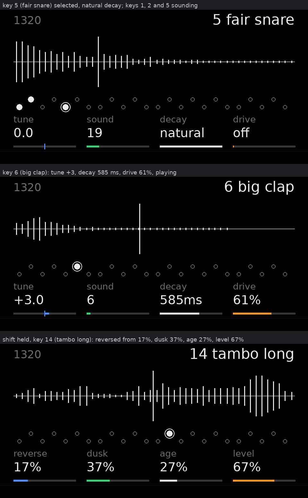
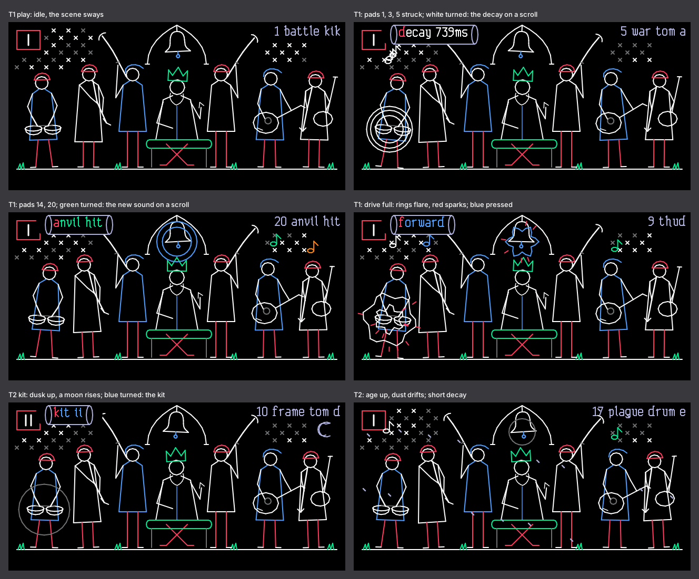

# Project_1320_perc
An OP-1 drum engine for the EP-1320 Medieval's percussion

**1320** is a native drum engine for **Opus 2.0 beta 4** on the original OP-1 (firmware 246). Every one of the 24
keys plays its own sound from a 96-sound bank, with its own tune, decay, drive, start, direction, dusk, age and
level, and the OS saves it all with the kit. It plays on an OP-1 with Opus 2.0 beta 4.

**This repository holds no audio.** The sounds are Teenage Engineering's EP-1320 Medieval factory sounds, so they
aren't here, and no built plugin is either. You make the bank from your own EP-1320 exports and build the plugin
yourself. The steps are in [`ep1320/README.md`](ep1320/README.md).

## Build it

1. Export the EP-1320 Medieval's sounds from your own device as WAV files (the file names start with the sound's
   number, e.g. `001 BATTLE KIK.wav`).
2. `python3 ep1320/tools/bank/build_bank.py "<your exports folder>"` writes `ep1320/md_bank.h`.
3. Build `ep1320.opmod` with the Opus 2 beta 4 plugin kit, as `ep1320/README.md` "Build" shows, and copy it to the
   OP-1's `mods` folder.

`md_bank.h` and `*.opmod` are in `ep1320/.gitignore`, so a build can't end up in a commit by accident.

## What's here

| File or folder | What |
|---|---|
| `ep1320/` | 1320 v0.3.0 for Opus 2 beta 4: the engine, the bank tools, the tests, the Blackfin cycle bench and the docs |
| `medieval-source.zip` | The source of medieval v0.2.3, the older Hundekraft Workshop version: the engine, the tests and cycle bench, the Opus 2 feasibility study, the changelog and the test results. It has no built files and no audio. |
| `media/` | The page previews and a screen GIF, rendered on a PC from the engines' own drawing code |
| `SHA256SUMS.txt` | Checksum of the source zip |

## Licence

The code and art are GPL-3.0-or-later with the OP-1 firmware permission (`ep1320/LICENSE` and `ep1320/NOTICE`). The
EP-1320 audio isn't part of this project and isn't covered by that licence: a bank or plugin you build from your
own exports is for your own use, so don't share it. EP-1320, OP-1 and Teenage Engineering belong to Teenage
Engineering AB. This is an unofficial fan project, not made or endorsed by Teenage Engineering.
