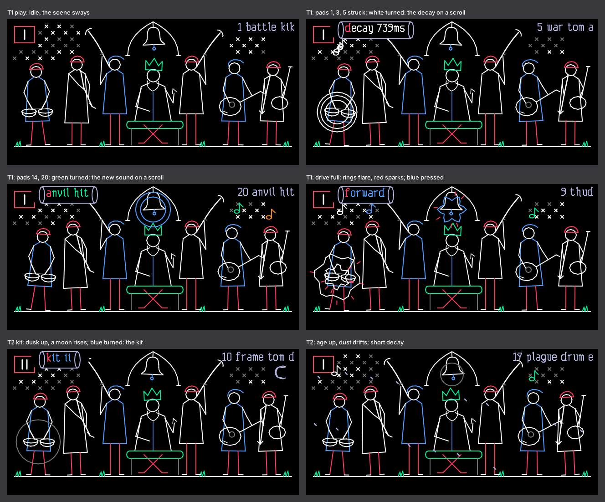

# Project_1320_perc
A OP-1 drum engine of the EP-1320

**medieval** puts the EP-1320 Medieval's percussion on the original OP-1's drum pads. It has 96 real EP-1320
recordings in four kits: war drums, frame drums, tambourines, clappers, coconuts, swords, chains, anvils, bells,
stabs and horns. Each pad plays any of the 96. Decay, drive, dusk and age shape the whole kit, and King David and his
musicians play along on the screen.

## Download

**[Download medieval.zip](https://github.com/SammiBabe666/Project_1320_perc/raw/main/medieval.zip)**: nothing to
build. Unzip it, pick the folder for the firmware mod your OP-1 runs, and follow `INSTALL.txt`.

| In the zip | For |
|---|---|
| `Hundekraft Workshop/medieval.knl` | The [Hundekraft Workshop](https://hundekraft.github.io/op1-workshop/) 3.0.x: add it under "Your plugins" and update the OP-1. It plays in drum mode, on all 24 pads, with the drum sequencers. |
| `presets/drum/medieval/` | Four drum kits (siege, crypt, jester feast, plague cart): copy the `medieval` folder into the OP-1 disk's `drum/` folder. |
| `INSTALL.txt` | The steps, the kits and the pages. |

**Opus 2:** not in the zip yet. [Opus 2](https://github.com/LizardMan245/opus) adds synth engines but has no drum
type. Its bridge runs Hundekraft synths, effects and sequencers, but not drum types. The Opus build waits for the new
bridge. `opus/FEASIBILITY.md` in the source zip has the details.

Checksums: [`SHA256SUMS.txt`](SHA256SUMS.txt).

**Demo:** [media/medieval_demo.mp4](media/medieval_demo.mp4) (one minute, with sound) and
[media/medieval_demo.wav](media/medieval_demo.wav). They show the four kits, then decay, drive, dusk, age, reverse
and pitch. [media/medieval_drum_screen.gif](media/medieval_drum_screen.gif) shows 4 s of T1 being played. All of them
were rendered on a PC from the engine's own code, dry. They were made with v0.2.2, and v0.2.3 gives the same samples
and draws the same pages.

## The pages

In drum mode, load a sampled kit, press Shift + T1 and choose the row named **drum+** (that is medieval's row). Then
T1 and T2 show the medieval pages. "The pad" is the last pad you played.

| | Blue | Green | White | Orange |
|---|---|---|---|---|
| **T1, play** | pitch (the pad, stock) | sound: any of the 96 | decay (the kit) | drive (the kit) |
| **T2, kit** | kit I to IV (all 24 pads) | start (the pad) | dusk (the kit) | age (the kit) |

Press blue on T1 for reverse, and green for one-shot or gate. Shift + orange on T1 sets the pad's volume. Everything
is saved in the kit.

## What's new in v0.2.3

It sounds the same as v0.2.2, sample for sample, and uses less processor time.

- **Fixed a click.** When a stock kit's hit took a voice that was still playing a medieval sound, the next medieval hit
  on that voice started with a jump (5,249 of 32,767 in the test). That's gone.
- **About a third of v0.2.2's processor time.** In the Blackfin simulator, twelve voices at the heaviest settings take
  576,384 cycles per render at worst, against 1,192,990 for v0.2.2 and 516,596 for v0.2.1, the version that played
  well on your OP-1. The 16-tap filter that made v0.2.2 cleaner is unchanged.
- **Safer hits.** A hit that an audio render interrupts can no longer mix two sounds.

The full list is in `release/CHANGELOG.md` in the source zip, and every test's output is in `release/test-results.txt`.

**Status: built and tested on a PC and in the Blackfin simulator, not yet on an OP-1.** The `.knl` passes the
Workshop's format tests. The same toolchain rebuilds v0.2.2's `medieval.knl` byte for byte. If v0.2.3 misbehaves,
`release/older/medieval-v0.2.2.knl` in the source zip is the previous build.

## What's here

| File or folder | What |
|---|---|
| `medieval.zip` | The download: the Workshop build, the four kits, `INSTALL.txt`, the licence |
| `medieval-source.zip` | The source and build files: the engine, the tests and cycle bench, the Opus 2 feasibility study, the built files, the changelog and the test results. Its `README.txt` says what is where. |
| `media/` | Demo video and audio, the page previews and the screen GIF |
| `SHA256SUMS.txt` | Checksums of the two zips and of `medieval.knl` |

## Licence

The code and art are GPL-3.0-or-later with the OP-1 firmware permission (`LICENSE` and `NOTICE` in both zips). The
sounds are Teenage Engineering's EP-1320 Medieval factory sounds, exported from your own device. They are in
`medieval.knl` and the kits, and they aren't covered by that licence, so keep this repository private. The source zip
leaves out `md_bank.h` for the same reason. EP-1320, OP-1 and Teenage Engineering belong to Teenage Engineering AB.
This is an unofficial fan project.
