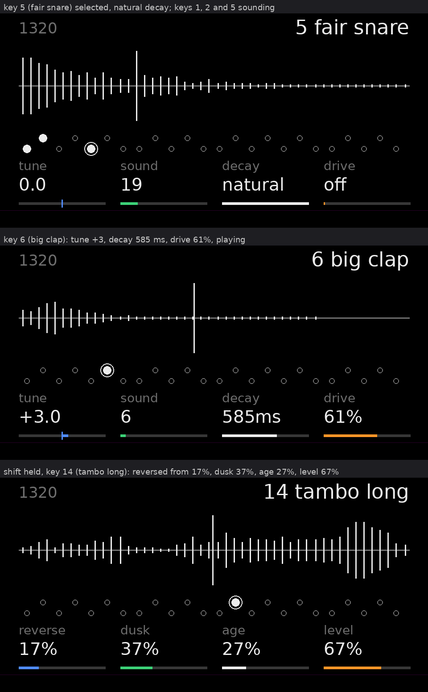

# 1320

The EP-1320 Medieval drum bank as a native drum engine for **Opus 2.0 beta 4** (core 2.30) on the original OP-1,
firmware #246. Version 0.3.0.

Every key of the drum kit plays its own sound from the 96 in the bank, with its own tune, decay, drive, start,
direction, dusk, age and level. The OS saves all of it with the kit, so a 1320 kit saves, loads, copies and goes into
the drum's preset browser like any other kit, and the drum LFO and the matrix can move every number.

This is the 1320 engine from Project Medieval rebuilt on Opus's own drum engine service (new in beta 4). Medieval was a
Hundekraft drum type that needed firmware hooks; 1320 uses only `opus_*` calls, no firmware addresses and no `place`
lines.



*Rendered on a PC from the page's own drawing code, with a stand-in font. It's not a photo of an OP-1.*

## Install

The `.opmod` holds the EP-1320 audio, so it isn't published with the source (see `NOTICE`). Build it yourself
(below) or use your own copy. The builds stay private.

1. Opus 2.0 beta 4 on the OP-1 (the beta's patcher page makes the update from your own `op1_246.op1`).
2. Disk mode (shift + COM, then T3). Copy `ep1320.opmod` into the disk's `mods` folder. Eject, switch off and on.
3. Opus menu (synth + drum + tape + mixer), T2: the mods list. The **1320** row should say *loaded*.
4. Drum mode, shift + T1: pick **1320** in the drum's engine list. A new kit comes up with the default 24 sounds.

If anything goes wrong, hold **Stop** while switching on: Opus starts with no plugins. The next start after a crash
leaves 1320 out ("skipped: crashed") and writes a crash log to the disk's `crash` folder. Please send me that file.

## Playing it

T1 shows the key you last played: its number and sound at the top, and a picture of that sound as this key will play
it (from its start, forwards or reversed, shaped by its decay). A line runs along the picture while it sounds. Below
the picture are the 24 keys (black keys raised): a ring marks the key the encoders turn, and a dot marks every key
that's sounding. At the bottom are the four values the encoders turn now.

| Encoder | Turn | With shift |
|---|---|---|
| blue | **tune**, ±24 semitones | **start**: up to 3/4 into the sound. Past halfway it plays **reversed** |
| green | **sound**, 1-96 | **dusk**: a low pass, open down to about 250 Hz |
| white | **decay**: 30 ms to 3 s to -60 dB, top step natural | **age**: sample and hold, fewer bits |
| orange | **drive**: a soft clip, level kept | **level** |

- Play a key to select it, then turn. T2 (envelope) and T4 (LFO) are the OS's own drum pages.
- The tambourines (hat, short, cap, tight, long and the shakes) **choke** each other like hi-hats. The tambo snare
  doesn't.
- The drum octave and the endless sequencer's transposition shift the pitch, as on any drum engine.
- Velocity counts, squared, so soft hits are clearly softer. The OP-1's own keys always play at full velocity.

### Default kit

Low F to E: battle kik, tambo hat, medium evil kik, tambo short, fair snare, tambo long, big clap, market snare,
clapper a, jester snare, coconut a, tight snare.
High F to E: war tom a, tambo cap, frame tom a, coconut b, deep tom a, clank a, anvil hit, sword clang, chain hit,
hell bell, stab a, royal kik.

Turn green on any key for the rest of the bank: the war drums, tavern, armory and royal court sounds.

### The voices setting

The mods list, the 1320 row, blue push: **voices at once**, 4 to 12, 8 to start. When a hit would go past it, the hit
that started longest ago fades out in about 1.5 ms. Eight is plenty for one-shot drums and keeps the engine light. Go
higher only if you hear hits cut short.

## What it costs

These figures come from GDB's Blackfin simulator (`bench/run.sh`). The simulator counts instructions, not the OP-1's
memory waits, so **the device will be somewhat higher. Nothing here has been measured on an OP-1 yet.** One audio
block is 580,525 cycles.

| Case (worst block, all voices together) | Cycles | Share of a block |
|---|---|---|
| 1 hit, plain | 6,747 | 1.2 % |
| 1 hit, drive + dusk + age + reversed + 2 octaves up | 15,360 | 2.6 % |
| 8 hits, plain (the default limit) | 53,976 | 9.3 % |
| 8 hits, heaviest, retriggered | 125,392 | 22 % |
| 12 hits, heaviest, retriggered (the setting at its top) | 188,088 | 32 % |

A typical pattern has two to four hits sounding at once, so expect roughly 15,000 to 30,000 cycles. The plugin's
`cpu` figure is **200,000, an estimate** that covers the heaviest case with all 12 voices, so Opus never switches it
off. For comparison, the starter pack's sim drum engine declares 113,165.

Silence costs nothing: a voice that has ended isn't rendered.

**Memory:** a 459,872-byte image (a 462,940-byte `.opmod`) (436,608 of it the sample bank, compiled in), 192 bytes for each of the 12 voices
(on a fast-memory lease while it plays), and one 4,896-byte table (the resampling filter and the ADPCM decoder) on a
fast-memory lease of its own. Opus takes both leases back about 2 seconds after the engine goes quiet, so other plugins
get the fast memory when 1320 isn't playing. There's no allocation after start-up.

## How it works

- **The bank:** 96 sounds, 11.025 to 22.05 kHz, IMA ADPCM in independent 64-sample blocks (medieval's bank,
  unchanged). A voice decodes only the block its filter reads.
- **The voice:** Opus asks a drum voice for 128 samples at 88.2 kHz. 1320 computes 64 at 44.1 kHz with a 16-tap
  windowed-sinc interpolation, then doubles them. The bank has nothing above 11 kHz, so nothing is lost, and the
  filter runs half as often.
- **One gain per sample:** decay, level and velocity fold into one ramp per block. Drive, dusk, age, a late start's
  fade-in, chokes and retrigger declicks run in a second pass, only when they're on.
- **Blackfin:** the filter loop is hand-scheduled assembly (`p_run.S`). It gives the same samples as the C the host
  tests check, and the bench checks that with a hash of every sample.
- **Click guards:** every sound ends faded to zero. A late start fades in over 64 samples, a retrigger fades the old
  sound out over 64, a choke fades out over 64, and the decay ramps within each block.
- **Thread safety:** a hit is filled while the voice is marked pending, so an audio block that lands mid-fill plays
  silence instead of half a hit. The voice limit leaves single-byte flags that the audio side reads. No pointer to a
  voice is kept past a call, so Opus can move the voices in and out of fast memory.

SIM and the matrix: 1320 doesn't need SIM's physics page or its orbit3d library. The matrix (or any LFO type) works
with it automatically, because every key number reaches the voice as the LFO left it.

## Build

You need the shared Blackfin toolchain (GCC 13.3.0, binutils 2.38) and the Opus 2 beta 4 plugin kit
(`opus2-plugin-kit-beta4-rc1.zip`, SHA-256 `5651bb76…39fed4f6`). The toolchain isn't part of this folder.

```sh
. ~/mnt/Documents/op1-toolchain/env.sh             # OP1_BFIN_TOOLCHAIN, BFIN_RUN
python3 tools/bank/build_bank.py "<ep1320 sounds>" # md_bank.h from your own EP-1320 exports (see below)
mkdir -p KIT/plugins/sammi.ep1320 && cp *.c *.h *.S manifest.txt cpu.txt KIT/plugins/sammi.ep1320/
cd KIT && python3 plugin_tool.py build plugins/sammi.ep1320   # build/ep1320.opmod
python3 plugin_tool.py show build/ep1320.opmod
```

**`md_bank.h` is not in the source.** It holds the EP-1320 audio (see `NOTICE`). Make it from your own exports with
`tools/bank/build_bank.py` (Python 3 with numpy and scipy, and a C compiler). The result should have SHA-256
`9bdb4fd9…7170c4bc` if your exports match the ones it was made from.

Generated files: `p_tables.h` (`python3 tools/gen_tables.py > p_tables.h`), `p_peaks.h` (`tools/gen_peaks.c`, see
its header), `md_names.h` (`python3 tools/bank/gen_names.py > md_names.h`).

## Tests

```sh
OPUS_SDK=KIT/sdk bash tests/run.sh   # host, under ASan and UBSan
bash bench/run.sh                    # Blackfin simulator: cycles, and the hashes the host printed
```

- `tests/host_test.c`: all 96 sounds forwards and reversed at three tunes end on their own. It also checks the
  largest step at a hit's start, a retrigger and a choke (no clicks), that a pending voice stays silent, tune ratios,
  velocity, level, drive and decay.
- `tests/engine_test.c`: `ep1320.c` driven the way a model of the OS drives a drum engine. It checks registration,
  the default kit, the voice limit at 4, 8 and 12 under random bursts, that every voice ends, and the tambourine
  choke.
- `tests/decode_test.c`: the table decoder matches the reference IMA decoder on all 12,128 blocks of the bank.
- `tests/page_check.py`: 300 random pages through the host mock. Everything stays inside the OP-1's window
  (y 2-146), and no text slot moves.
- `bench/`: cycles per case, plus a hash of every sample that must equal the host's (the Blackfin build plays the
  same samples).

See `test-results.txt` for the last run.

## Not tested yet

Everything that needs an OP-1: loading on beta 4, the sound through the OS's mixer, the page on the real screen and
font, kits saving and loading, the drum LFO and the matrix on its numbers, the CPU figure, and running beside other
plugins. Only after you've tried it does the manifest get a `checked device` line and `cpu.txt` a measured figure.

## Files

| File | What |
|---|---|
| `ep1320.c` | the engine: registration, the default kit, hits, voice limit, choke groups |
| `p_voice.c`, `p_voice.h` | one voice: decoding, interpolation, decay, effects, click guards |
| `p_run.S` | the Blackfin filter loop |
| `p_page.c`, `p_page.h` | the T1 page |
| `p_tables.h`, `p_peaks.h`, `md_names.h` | generated tables, the sounds' outlines, the names |
| `manifest.txt`, `cpu.txt` | the plugin's manifest and CPU figure |
| `tools/` | table and outline generators, the bank tools, the page preview |
| `tests/`, `bench/` | host tests, simulator bench |

## Changes

- **0.3.0** (2026-11-06): first Opus build. A native beta 4 drum engine (core 2.26 and up) with a per-key sound and
  eight numbers, 12 voices with a limit setting, tambourine chokes, a new 44.1 kHz voice, and a new monochrome T1
  page. It follows medieval 0.2.3 (Hundekraft drum type).

Licence: GPL-3.0-or-later with the OP-1 firmware permission. The EP-1320 audio isn't covered (see `NOTICE`).
